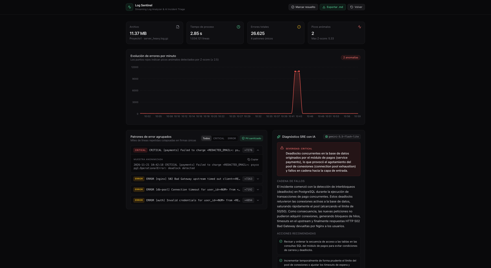
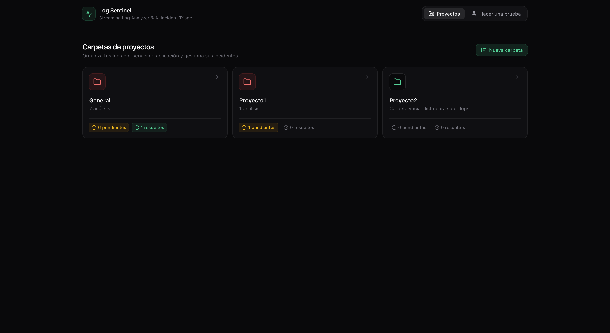

# Log Sentinel

**Streaming Log Analyzer, Anomaly Detector & AI Incident Triage**

Log Sentinel es una herramienta SRE diseñada para ingerir y analizar archivos de logs masivos (`.log`, `.txt` y `.log.gz` de 100 MB+) en streaming con memoria acotada, detectar picos anómalos mediante análisis estadístico (*Z-Score*), anonimizar datos sensibles (PII) automáticamente y generar diagnósticos de causa raíz asistidos por IA con Gemini.

---

## Características principales

* **Procesamiento en streaming (memoria acotada):** Lectura por bloques de 64 KB con descompresión `.gz` al vuelo mediante `zlib`, permitiendo procesar más de **1 millón de líneas (100 MB) en ~2.8 segundos** sin saturar la RAM.
* **Detección estadística de anomalías (Z-Score):** Agrupación temporal por minuto y detección automática de picos anómalos (`Z-score > 2.5`) frente a la media base.
* **Clustering de errores y sanitizado PII:** Colapsa miles de líneas repetidas en firmas únicas y censura automáticamente correos electrónicos, direcciones IP y valores dinámicos antes de mostrar muestras o enviar contexto a la IA.
* **Diagnóstico SRE con Gemini:** Envía únicamente el resumen estadístico y las firmas anonimizadas para obtener severidad, causa raíz, cadena de fallos y plan de mitigación.
* **Gestión de incidentes y persistencia en PostgreSQL:**
  * Organización por **carpetas de proyectos/servicios**.
  * Flujo de estado tipo Trello (**Pendientes** / **Resueltos**) con agrupación automática por día (*Hoy*, *Ayer*, fecha).
  * Reapertura instantánea de análisis y diagnósticos guardados sin volver a procesar ni consumir tokens.
* **Modo Prueba interactivo (Sandbox):** Guía visual en 3 pasos para probar la herramienta rápidamente sin mezclar logs de prueba con proyectos reales.
* **Exportación Post-Mortem (`.md`):** Descarga de un informe SRE completo en Markdown listo para Jira, Slack o GitHub Issues.
* **Validación estricta de archivos:** Bloqueo en frontend y backend de formatos no admitidos, archivos vacíos o binarios corruptos.

---

## Capturas de pantalla

| Dashboard de análisis y anomalías | Carpetas de proyectos e historial |
| :---: | :---: |
|  |  |

---

## Arquitectura y Stack Tecnológico

* **Backend:** Python 3.12 · FastAPI · SQLAlchemy · PostgreSQL · Google GenAI SDK (Gemini) · `pytest`
* **Frontend:** React · TypeScript · Vite · Tailwind CSS · Recharts · Lucide Icons
* **Infraestructura:** Docker · Docker Compose

```text
log-sentinel/
├── backend/
│   ├── app/
│   │   ├── api/routes.py        # Endpoints /analyze, /diagnose y CRUD /history
│   │   ├── core/
│   │   │   ├── parser.py        # Streaming chunked + descompresión .gz al vuelo
│   │   │   ├── anomaly.py       # Detección de picos por Z-Score
│   │   │   ├── clusterer.py     # Normalización y agrupación de patrones
│   │   │   ├── scrubber.py      # Sanitizado automático de PII
│   │   │   └── ai_client.py     # Cliente Gemini para diagnóstico SRE
│   │   ├── database.py          # Conexión SQLAlchemy + PostgreSQL
│   │   ├── models.py            # Modelo AnalysisRecord con índices
│   │   └── main.py
│   ├── test/test_core.py        # Batería de tests unitarios con pytest
│   └── requirements.txt
├── frontend/
│   └── src/
│       ├── components/          # Dropzone, TimelineChart, ErrorClusters, DiagnosisPanel,
│       │                        # HistoryList, ProjectFolders, SandboxMode
│       ├── services/api.ts      # Cliente API + progreso real de subida (XHR)
│       └── utils/exportMarkdown.ts
└── docker-compose.yml
```

---

## Puesta en marcha

### 1. Requisitos previos
* [Docker](https://www.docker.com/) y Docker Compose
* Una API Key de [Google AI Studio (Gemini)](https://aistudio.google.com/)

### 2. Configurar variables de entorno
Crea un archivo `.env` en la raíz del proyecto:

```env
GEMINI_API_KEY=tu_api_key_de_gemini
```

### 3. Levantar el stack completo

```bash
docker compose up -d --build
```

* **Frontend:** [http://localhost:5173](http://localhost:5173)
* **Backend (Swagger UI):** [http://localhost:8000/docs](http://localhost:8000/docs)

---

## Tests

El backend incluye una batería de tests con `pytest` que valida el sanitizado PII, el clustering de patrones, la detección de anomalías Z-Score, el streaming de `.log`/`.log.gz` y el rechazo de binarios o archivos vacíos:

```bash
docker compose exec backend pytest -v
```

---

## Benchmark de referencia

Pruebas realizadas en entorno local con Docker sobre un archivo sintético de producción (`server_heavy.log` y su versión comprimida `server_heavy.log.gz`):

| Archivo | Tamaño | Líneas procesadas | Tiempo total | Patrones colapsados |
| :--- | :---: | :---: | :---: | :---: |
| `server_heavy.log` | 100 MB | 1.034.121 | ~2.86 s | 26.625 errores → 4 firmas |
| `server_heavy.log.gz` | 11.37 MB | 1.034.121 | ~2.80 s | 26.625 errores → 4 firmas |

---

## Autor

**Juan Diego Delgado Morente** — [GitHub @Juandi01](https://github.com/Juandi01)